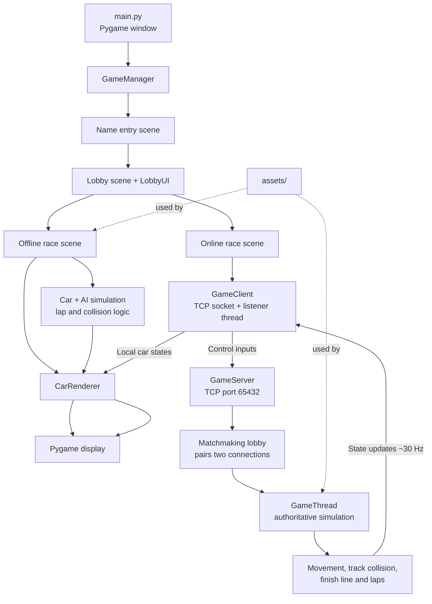

# Multiplayer Car Game

A Python and Pygame racing game with offline play against an AI car and an online two-player mode over TCP sockets.

## Requirements

- Python 3
- Pygame

Install Pygame if needed:

```bash
python -m pip install pygame
```

## Run the game

Start the game UI:

```bash
python main.py
```

Enter a name, then choose offline or online from the lobby. In offline mode you race against an AI car. Use the arrow keys to drive. Clicking the track during offline play adds a waypoint to the AI route.

### Online multiplayer

1. Start the server:

   ```bash
   python server.py
   ```

2. Start the game with `python main.py` on two players' computers and choose **Play Online** on each.
3. Each client waits until another player connects. The server pairs clients in the order they arrive and starts a two-player race.

The server currently binds to `127.0.0.1` on port `65432`, so it accepts connections from the same computer only. For LAN or internet play, configure the server to bind to a reachable interface and update the client host in `network/client.py`; network/firewall routing may also need to allow TCP port `65432`.

## Controls

- **Up arrow:** accelerate
- **Down arrow:** reverse/brake
- **Left / right arrows:** steer while moving

## Architecture



- `main.py` creates the Pygame window and starts `GameManager`.
- `core/game_manager.py` coordinates the name-entry and lobby screens.
- `scenes/` contains the lobby, name entry, offline race, and online race screens.
- `ui/` contains lobby UI and reusable buttons.
- `cars/` and `players/` contain car movement/state and player models, including the offline AI player.
- `logic/` contains shared game rules such as lap counting, finish-line checks, and lobby car selection.
- `rendering/` draws cars; `audio/` manages sound.
- `network/client.py` and `network/server.py` implement online play.
- `assets/` contains track, car, and sound files.

### Offline mode

`scenes/play_offline.py` runs the simulation and rendering in one Pygame loop. It updates the human and AI cars, checks collisions against a mask made from the track border, validates finish-line crossings, and counts laps.

### Online mode

Online play uses a server-authoritative model:

1. `network/server.py` listens for TCP connections on port `65432`. Each new connection is added to a waiting lobby.
2. When two clients are waiting, the server pairs them and starts a `GameThread` for their match.
3. The match thread creates both cars and owns the simulation. It processes player controls, updates movement, checks track collisions and lap completion, and broadcasts game state at about 30 ticks per second.
4. `scenes/play_online.py` sends the local keyboard state and draws the track and cars. `network/client.py` has a background listener thread that receives server messages and updates the local player and opponent states.
5. When the server ends the match, it sends an `end` message and closes the clients' connections.

Messages are JSON encoded and sent over TCP with a four-byte, big-endian length prefix. The prefix tells the receiver how many bytes make up the next message, since TCP does not preserve message boundaries.

The online protocol uses these message types:

- `status`: the client has connected and is waiting for an opponent.
- `start`: player/car setup and initial states for the match.
- `game_update`: current car states and lap totals.
- `end`: the match has ended.

## Current online-mode notes

- The online server currently creates players named `Player 1` and `Player 2` and assigns fixed car images. The name and car selected in the lobby are not sent to the server yet.
- The match size is fixed at two players.
- The server and client default to `127.0.0.1:65432`; both must be configured for play across separate computers.
- `network/network_utils.py` is a standalone terminal networking example and is not used by the Pygame online game.

## Project structure

```text
assets/       Track, car, and sound assets
audio/        Sound manager
 cars/        Car movement and AI car
 core/        Application/game manager
 logic/       Lap, finish-line, and game rules
 network/     Online TCP client and server
 players/     Player and AI player models
 rendering/   Car drawing helpers
 scenes/      Name entry, lobby, offline and online screens
 ui/           Lobby widgets and buttons
 main.py       Application entry point
 server.py     Online game server entry point
```
